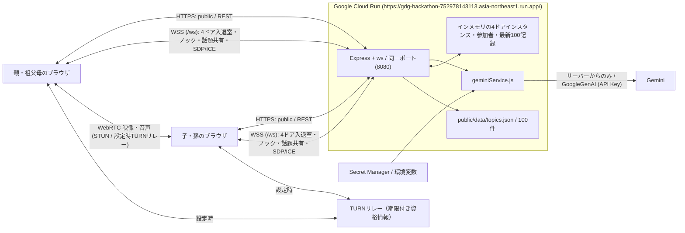

# となりドア — アーキテクチャ仕様書 (ARCHITECTURE.md)

- **チーム名**：Generator-Critic — `yoikoarmor` (小沢司), `suzukimain` (鈴木崇博)
- **大会・カテゴリ**：GDGoC Japan Hackathon 2026 (DF Hack26) / 医療・福祉
- **本番デプロイURL (Google Cloud Run)**：https://gdg-hackathon-752978143113.asia-northeast1.run.app/

---

## 1. 実装構成とシステム全体像

- **`server/index.js`**：`PORT`（既定 `8080`）、`0.0.0.0` で待受。Express が `public/`、REST API、同じ HTTP サーバー上の `/ws`（WebSocket）を提供する。
- **`server/geminiService.js`**：`@google/genai` の `GoogleGenAI`（`GEMINI_API_KEY`）を用いて、退室後の安心見守りレポート生成（`generateCareSummary`）および団らん話題カード生成（**TBW** / `generateDanranTopic`）を行う。事前気配抽出は廃止。`analyzeDoorPresence` 関数は残存するが未使用で、対応するREST API・画面は提供しない。
- **`public/data/topics.json`**：100件の初期話題カードデッキ（10カテゴリ）。
- **`public/index.html`, `public/styles.css`, `public/app.js`**：4つのドアが並ぶ廊下（ロビー）UI、WebRTC ピア接続（相手専用メイン映像枠。自動再生ブロック時の専用復帰UIは未実装）、実カメラ／バーチャル茶の間カメラ切替、話題カードデッキ、見守りノートを描画する。アプリのExpressサーバーは映像・音声を中継・録画しない。TURN利用時は別のリレーサーバーが暗号化されたメディア通信を中継する。

---

## 2. 体験とデータフロー（4つの独立ドア＝ルームインスタンス方式）

1. **STEP 1：4つのドアの明かりを見る（ロビー同期）**
   - `GET /api/doors` と WebSocket `join_lobby` で4つのドア（① `chanoma`: 実家の茶の間、② `engawa`: 日当たりのいい縁側、③ `kitchen`: 夕暮れの台所・ダイニング、④ `hobby`: みんなの趣味部屋）の現在状態を同期する。
   - 初期状態ではすべて「空室（`participants: []`, `participantCount: 0`, `isOpen: false`, `statusText: "空室 — ノックして団らんを始める"`）」。
2. **STEP 2：ノックして部屋に入る**
   - `knock_door` でノック音を通知し、ブラウザがカメラON（実カメラまたはバーチャル茶の間カメラ）を準備して `enter_door` を送信する。
   - 1人が入室するとそのドアに明かりが灯り、廊下のドア表示が **`-${accountName}-がくつろいでいます。`** に変わる。2人以上が入室すると **`-${先頭accountName}-ほか計${n}人が団らん中`** となる。
3. **STEP 3：顔を見て、団らんする（WebRTC P2P ＋ 話題カード共有）**
   - 同じドアに入室した参加者同士で WebSocket `webrtc_signal` により SDP/ICE を交換し、WebRTC で双方向ビデオ通話を行う。1人入室時は提灯の待機カードを表示し、2人目が入室した瞬間に待機カードを隠して相手のカメラ映像をメイン枠に表示する。
   - 話題カードは100選からランダムに引く（`GET /api/topics/random`）ことができ、`share_topic` で同室者全員へリアルタイム同期する（※Gemini による動的話題カード生成は **TBW**）。
4. **STEP 4：安心をノートに残す（退室・見守り要約）**
   - 退室時に通話時間・参加者・話した話題・気づきメモを `POST /api/summary` に送り、Gemini が非医療的な会話の活気の目安（`vitalityScore`）、様子の要約（`mood`, `highlights`）、次回の話題提案（`nextTopicSuggestion`）を生成して「📓 安心見守りノート」に保存する。

---

## 3. REST API 契約一覧

| API | 返却形・挙動 |
|---|---|
| `GET /api/health` | `{ ok, service, geminiConfigured, model, timestamp }` |
| `GET /api/doors` | `{ doors: [...] }`。4つのドアの現在の入室者配列 `participants`、`participantCount`、`isOpen`、`statusText` を返す |
| `GET /api/topics/random?category=...` | `{ topic, totalPool, source: "curated-100" }`。100選デッキからランダムに1件返す |
| `POST /api/topics/generate` | **TBW**（実装上は `{ topic, source }` を返し、AI未設定時は100選からフォールバック） |
| `POST /api/summary` | 入力 `{ doorName, participants, durationSec, topicsUsed, notes }` から `{ summary, source }` を生成しメモリ上の見守りノートに保存 |
| `GET /api/logs` | `{ logs: [...] }`。新しい順に最大100件の見守りノート記録を返す |
| `GET /api/walk-config` | Street View 散歩設定（`{ apiKey, places }` を返す。現在は有効化フラグなし。キー未設定時は景色を表示できない） |

## 現在の実装状態（2026-11-09確認）

- GeminiはAPIキーで呼び出す。`GEMINI_MODEL` の既定値は `gemini-2.5-flash`。本番ヘルスで確認した設定は `gemini-3.5-flash-lite`。実際の生成成功・モデル性能をこの確認だけで保証しない。Vertex AI経路は現在未対応。
- 話題カード100選の抽選・共有は実装済み。Gemini話題生成は**TBW**（画面ボタン無効）。内部APIとサービス関数は存在する。
- 要約へ送るのは時間・参加者・話題・気づきメモ。映像・音声の解析は行わず、根拠のない元気度は未評価。話題生成失敗時は100選、要約失敗時は入力に基づく簡易記録にフォールバック。
- 事前気配抽出とデモ人物は廃止。`analyzeDoorPresence` 関数は未使用で残存するが、対応REST API・UIは提供しない。
- 自動再生ブロック時の専用復帰UIは未実装。TURN設定取得・期限付き資格情報は実装済みだが、実回線での接続検証は別途必要。
- 散歩は有効化フラグなし。`GET /api/walk-config` は `{ apiKey, places }` を返し、景色表示にはMapsキーが必要。
- 見守りノートはサーバーのメモリに最大100件を保持し、再起動で失われる。家族認証・Firestore永続化は未実装。
- 実カメラでは顔を確認できる。バーチャル茶の間カメラも参加できるが、本人の顔は映さない。
