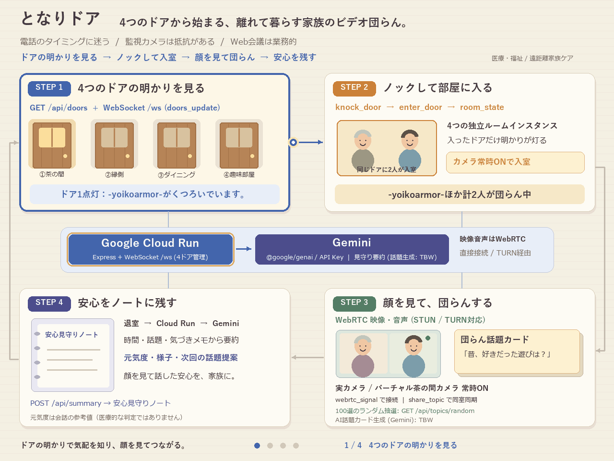
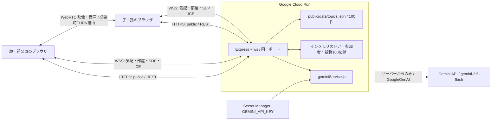

# となりドア — アーキテクチャ

Generator-Critic / GDGoC Japan Hackathon 2026 / 医療・福祉。離れて暮らす家族が「今、声をかけてよいかな」と迷う負担を減らし、顔を見て過ごす団らんにつなげる。



## 実装構成



- `server/index.js`：`PORT`（既定8080）、`0.0.0.0`で待受。Expressが`public/`、REST、同じHTTPサーバー上の`/ws`を提供する。`require()`では待受を開始せず、`{ app, server }`を公開する。
- `server/geminiService.js`：`@google/genai`の`GoogleGenAI`で3種類の生成を行う。モデルは既定`gemini-2.5-flash`で、`GEMINI_MODEL`で変更できる（空白だけなら既定値）。APIキーは`process.env.GEMINI_API_KEY`だけから読む。
- `public/data/topics.json`：100件の初期デッキ。APIが使えないときも団らんを継続できる。静的カードの選択とGemini生成は`source`で区別する。
- フロントエンドの担当は別系統。カメラ取得、デモ用Canvas映像、WebRTCピア接続、WSS再接続、ドア・話題カードの描画を担う。サーバーは映像・音声を中継・録画しない。

## 体験とデータフロー

1. `GET /api/doors`と`join_lobby`で入口を同期する。初期4ドアは`chanoma`、`engawa`、`kitchen`、`hobby`。初期在室者は順に「おばあちゃん」「母（実家）」「kaigunn_2020」「yoikoarmor」。初期値はデモ設定で、実在者の安否を示さない。
2. 本人が在室設定を変更すると`POST /api/doors/:id/presence`が即座に`doors_update`を配信する。`mode=relaxing`の表示はサーバーが厳密に **`-${accountName}-がくつろいでいます。`** と組み立てる。Geminiには表示文を決めさせない。busy/awayでも`-name-`を保持する。
3. 同意して送った静止画・短い状況メモだけからGeminiが声かけタイミングを抽象化する。`good` / `maybe` / `busy`と短い説明を返す。画像は保存・ブロードキャストしない。AI応答待ちの間も在室設定を配信し、後から届いた古い解析は破棄する。本人のbusy/away指定をAIが上書きしない。
4. `knock_door`でノックを知らせ、ブラウザがカメラONまたは明示的なデモ映像を準備して`enter_door`する。サーバーも`videoEnabled === true`を必須とする。ただしクライアントの申告なので、実際の映像トラックの存在はブラウザ側でも検査する必要がある。
5. 同じ部屋の参加者だけでSDP/ICEを交換し、WebRTCで顔を見て話す。話題は100件から引くかGeminiで生成し、`share_topic`で同室者へ同期する。
6. 退室時に時間、参加者、使った話題、任意メモを`POST /api/summary`に送る。録音・録画・表情解析を自動で行ったという扱いにはしない。記録は最新100件をメモリに保持する。元気度は医療的な健康判定ではなく、メモを根拠とする会話の活気の参考値。根拠不足時・AI失敗時は`null`/未評価とする。

## REST契約の補足

基本契約は[API_CONTRACT.md](API_CONTRACT.md)。未定義だった返却形を次のように具体化する。

| API | 返却形・挙動 |
|---|---|
| `GET /api/health` | `{ ok, service, geminiConfigured, model, timestamp }`。キー有無の確認でありGemini疎通確認ではない |
| `GET /api/doors` | `{ doors: [...] }`。`participants`は表示名配列、`participantCount`は初期在室者と接続中の参加者の表示名を重複除去した数 |
| `POST /api/doors/:id/presence` | `{ door, doors }`。modeは`relaxing`（既定）/`busy`/`away`。画像はJPEG/PNG/WebPのdata URL、またはJPEGの生Base64 |
| `GET /api/topics/random?category=...` | `{ topic, totalPool, source: "curated-100" }`。`totalPool`はカテゴリ適用後の件数。カテゴリ未一致は404 |
| `POST /api/topics/generate` | `{ topic: { id, category, topic, hint }, source }`。生成IDは`gemini-UUID`、初期カードIDは数値。`source`は`gemini`または`curated-100` |
| `POST /api/summary` | 入力`{ doorName, participants, durationSec, topicsUsed, notes }`。participantsは表示名、または`{accountName}`の配列。topicsUsedは話題カードまたは話題文の配列。返却`{ summary, source }` |
| `GET /api/logs` | `{ logs: [...] }`。新しい順。各記録は`id, doorName, participants, durationSec, topicsUsed, title, vitalityScore, mood, highlights, nextTopicSuggestion, createdAt, source` |

不正入力400、未知ドア/カテゴリ/API404、過大JSON413、頻度制限429をJSONの`{ error }`で返す。生成失敗時は500ではなくフォールバック結果を返す。HTTP JSON上限6MB、画像文字列上限5,600,000文字、名前80文字、在室メモ1,000文字、要約メモ4,000文字。POST生成系は接続元IPごとに合計120回/分。同一プロキシ配下では制限を共有するため、Cloud Run上では保守的な共通制限になり得る。

サービス層の公開関数：

- `analyzeDoorPresence(...)` → `{ statusText, timingScore, timingLabel, aiDetail, source }`
- `generateDanranTopic(...)` → `{ topic: { id, category, topic, hint }, source }`
- `generateCareSummary(...)` → `{ title, vitalityScore, mood, highlights, nextTopicSuggestion, createdAt, source }`

キー未設定、サンプルキー、レート制限、タイムアウト、不正JSON、不正な生成値ではフォールバックする。Gemini呼出しは同時4件・最大12秒で制限し、過剰時は即座にフォールバックする。プロンプト・画像・SDKエラー本文・APIキーをログに出さない。利用者が送った内容はGeminiへの外部送信を伴うため、フロントエンドで同意を取る。

## WebSocketの具体化

接続先は同一オリジンの`/ws`。クライアントメッセージ型は契約どおり`join_lobby / knock_door / enter_door / leave_door / share_topic / webrtc_signal`。

- 接続直後と`join_lobby`の応答で`{ type: "doors_update", clientId, doors }`を送る。`clientId`は接続ごとのUUID。
- `room_state`の`participants`は実際に接続中のピアのみの`[{ id, accountName, videoEnabled: true }]`。受信者自身のIDを`selfId`で付加する。初期ドアの在室者表示は実ピアとして扱わない。相手が未接続ならWebRTC映像は届かず、フロント側でデモであることを明示する。
- `enter_door`で移動前の部屋から退出し、同室者全員へ`room_state`、全接続へ`doors_update`を配信する。重複入室は人数を増やさない。同室の上限8接続、全体100接続。
- `webrtc_signal.targetId`には`participants[].id`を指定する。送信者・送信先とも同じ部屋にいる場合だけ中継する。`fromId`と`accountName`はサーバーが接続情報から設定する。`payload`はSDP/ICE等のJSONオブジェクトで、メディアは含めない。
- ノックはロビーも含め全接続に通知する。共有話題は同室者にだけ配信し、`drawnBy`は接続のアカウント名を採用する。最後の参加者が退室したら共有話題を消去する。
- 不正なメッセージには`{ type: "error", requestType, code, message }`を返し、処理を継続する。64KiB上限、1接続300メッセージ/分。30秒間隔のping/pongと切断時の退室処理で参加者を清掃する。
- 再接続するとIDは変わる。フロントはバックオフで再接続し、`join_lobby`→カメラ確認→`enter_door`→新IDでSDP/ICE再交換を行う。古いピア接続は閉じる。

## Cloud Runで動かす

Node.js 20以上、依存関係は既存`package-lock.json`を使う。

```powershell
npm ci
Copy-Item .env.example .env
# .env の GEMINI_API_KEY を設定（未設定のままでもフォールバックで起動可能）
npm start
# 別ターミナルで
npm test
```

ローカルは`http://localhost:8080`。フロント実装がない段階でも`/api/health`等は利用可能。実機のカメラ取得にはlocalhostまたはHTTPSが必要。`npm test`は実APIキーを使わず、SDKモックとローカルHTTP/WSS相当のWS接続で契約を検証する。

以下はデプロイ手順例であり、この変更でクラウド資源は作成していない。事前に課金・API・Cloud Build/Artifact Registry・Secret Managerへの権限を用意する。

```powershell
$projectId = 'YOUR_PROJECT_ID'
$region = 'asia-northeast1'
gcloud config set project $projectId
gcloud services enable run.googleapis.com cloudbuild.googleapis.com artifactregistry.googleapis.com secretmanager.googleapis.com
# Secret Managerにgemini-api-keyを登録し、実行サービスアカウントに当該シークレットの
# roles/secretmanager.secretAccessor を付与する。キーをCLI引数やGitへ書かない。
gcloud run deploy tonari-door-danran --source . --region $region --allow-unauthenticated --port 8080 --timeout 3600 --concurrency 80 --min-instances 1 --max-instances 1 --session-affinity --set-secrets GEMINI_API_KEY=gemini-api-key:latest
```

ソースデプロイ時は`.gcloudignore`、コンテナビルド時は`.dockerignore`で`.env`、認証ファイル、ローカル作業データ等を確実に除外してから実行する。現行Dockerfileは`COPY . .`を使うため、この除外設定は公開前の必須作業。実行サービスアカウントは専用の最小権限アカウントを推奨する。発行されたHTTPS URLと`wss://同ホスト/ws`を利用する。

Cloud RunはWebSocketも通常のリクエストとして扱い、最大60分で切断する。session affinityは最善努力で、別端末を同一インスタンスへ集める保証はない。[公式WebSocketガイド](https://docs.cloud.google.com/run/docs/triggering/websockets)

今回のデモは最大1インスタンスを指定してメモリを共有する。ただしリビジョンの更新・再起動・一時的なインスタンス重複でも状態が失われる/分離する可能性がある。`min-instances=1`もデータ永続化を保証しない。トラフィックを複数リビジョンへ分割しない。本番・複数インスタンス構成ではFirestoreにドア・記録を保存し、FirestoreリスナーやRedis Pub/Subで部屋・シグナリングをインスタンス間同期する。現実装にFirestoreの永続化は含まれない。[公式セッションアフィニティ説明](https://docs.cloud.google.com/run/docs/configuring/session-affinity)

WebRTCはCloud RunのHTTPサーバーを映像中継に使わない。異なる家庭のNAT越えではSTUNに加えてTURNが必要になる場合がある。TURNサービスの選定・短命認証情報・`iceServers`設定は別途必要で、Cloud Runの公開URLだけでは接続成功を保証しない。

## プライバシーと公開範囲

この実装は認証なしのハッカソンデモ。アカウント名は本人認証ではなく、ドア・記録は接続者間で共有される。実家庭の情報を入れる運用にはFirebase Authentication等で家族グループと操作権限を確立し、REST/WS双方に認可を追加する。オリジン検査と頻度制限は本人認証を代替しない。ブラウザからの異なるオリジンのPOST/WSは拒否するが、ネイティブクライアントは接続できる。

生画像はリクエスト処理中のみ扱い、記録には保存しない。サーバーは生音声・映像を収集しない。要約・メモも本人の同意と家族単位のアクセス制御が必要で、保持期間・削除操作は本番化時に追加する。フォールバック時には健康状態や元気を捏造せず「未評価」を返す。

## 審査基準24点との対応と残る確認

各項目3点・計24点を目指す設計であり、得点・大会規則への適合を保証するものではない。基準と開催条件はリポジトリの`AGENTS.md`に基づく。

| 項目 | 設計・実装上の根拠 | 結合・提出前に確認すること |
|---|---|---|
| Google技術が中核 | Geminiの画像/文脈による気配、話題生成、要約 | 実キーで3機能が`source=gemini`になること |
| 採用理由の合理性 | マルチモーダルGeminiとHTTP/WSをまとめるCloud Run | 実クラウド稼働と採用理由をピッチに記載 |
| 一連の動作 | ドア→ノック→映像→話題→記録のAPI/WS | 別担当UIと2端末で通し検証 |
| 対象者向けUI/UX | 固定した温かい気配文、単純なAPI | 大きな文字・ワンタップ・カメラ拒否時の導線 |
| 安全性・拡張性・保守性 | サーバー側キー、画像非保存、入力制限、サービス分離 | ビルド除外設定、認証、永続化、TURN |
| 社会課題が具体的 | 遠距離家族の電話のためらいと監視への抵抗 | 家族の利用場面を説明文・動画に反映 |
| 課題への有効性 | 抽象化した声かけタイミングと顔を見た団らん | 高齢者を含む利用者で有用性を確認 |
| デモの明瞭さ | 4ドア・100話題・キーなし継続・記録API | デモ映像と実映像を区別した2画面デモ |

提出準備にはREADME（セットアップ/デプロイ/図）、デプロイURL維持、説明資料・動画・著作物利用シート・ピッチの整備が残る。READMEとフロントは実装済み。提出資料のURL欄は未記入のため、実デプロイ後の確認が必要。OSSは既存依存のライセンスを著作物利用シートに記載する。2026-11-10 19:00 JST以降のコードフリーズとRegional Day終了までのURL維持は`AGENTS.md`に従う。

SDKの構造化出力と画像入力は[Google GenAI SDK公式ソース](https://github.com/googleapis/js-genai/blob/main/src/types.ts)およびインストール済み`@google/genai`の型定義を参照した。モデル出力はJSONスキーマに加えアプリ側でも検証する。
