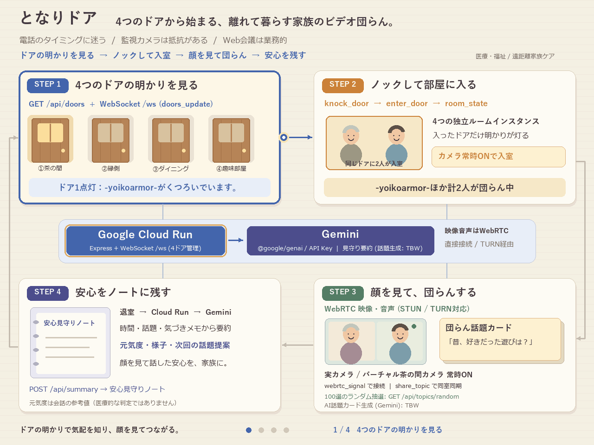
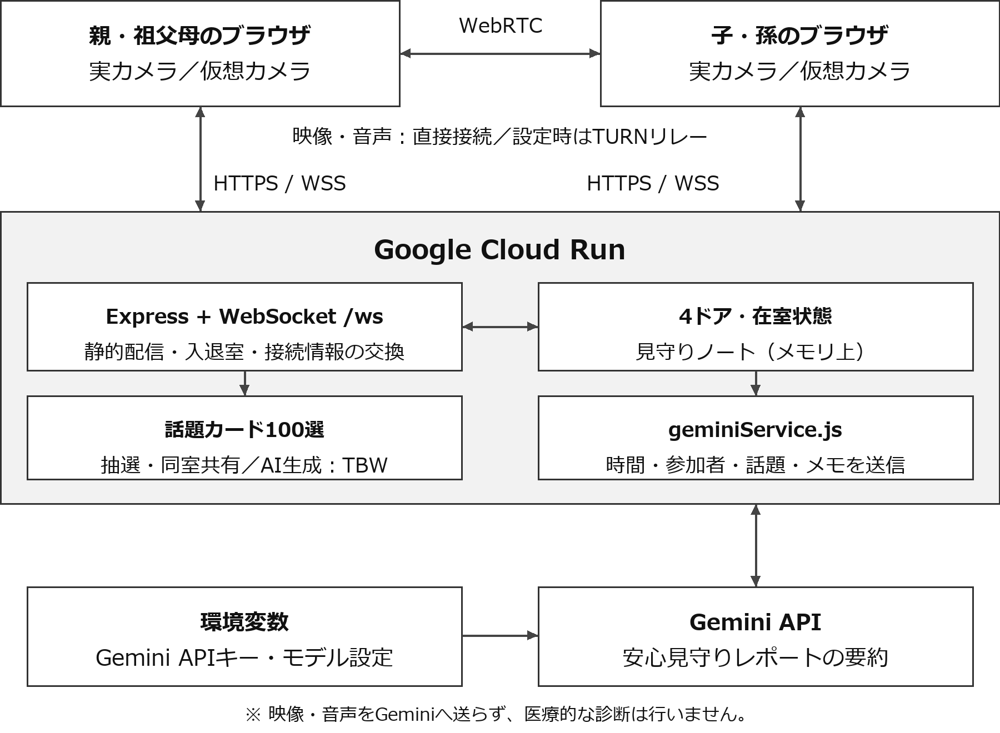

# となりドア (Tonari Door) — 4つのドアから始まる、離れて暮らす家族の団らんビデオアプリ

**GDGoC Japan Hackathon 2026 (DF Hack26) 提出プロダクト**



- **チーム名**：Generator-Critic
- **メンバー**：`yoikoarmor` (小沢司), `suzukimain` (鈴木崇博)
- **参加会場**：Tokyo Regional
- **対象カテゴリ**：1. 医療・福祉（高齢者見守り・遠距離家族ケア・孤立防止）
- **デプロイURL（Google Cloud Run）**：https://gdg-hackathon-752978143113.asia-northeast1.run.app/
- **開発用リポジトリ**：https://github.com/yoikoarmor/GDG-hackathon
- **提出用リポジトリ**：https://github.com/Devfest-Hackathon-2026/df-2026-t043

### 提出ドキュメント

- [最終版PDF（全7ページ）](docs/PRODUCT_DOCUMENT.pdf)
- [説明ドキュメント（Markdown）](docs/PRODUCT_DOCUMENT.md) / [閲覧・印刷用HTML](docs/PRODUCT_DOCUMENT.html)
- [アーキテクチャ仕様](ARCHITECTURE.md) / [API・WebSocket契約](API_CONTRACT.md)
- [引継ぎ資料](docs/HANDOVER.md)

---

## 1. 解決する社会課題とプロダクトの価値

### 社会課題
離れて暮らす親や祖父母の様子が気になるものの、毎日訪ねたり電話したりするのは簡単ではありません。
- **電話のハードル**：「今忙しいかな？」「特別な用事がないのに電話するのは気が引ける」と躊躇してしまう。
- **監視カメラへの抵抗感**：見守りカメラはプライバシー侵害や「監視されている」という心理的抵抗が強い。
- **Web会議ツールの業務感**：ZoomやMicrosoft Teamsなどの会議を中心とした体験は、家族が「ふらっと顔を出して団らんする」使い方にはなじみにくいと考えました。

### 目的

「用事がないと電話しづらい」「見守りカメラには抵抗がある」という負担を減らし、ビデオ通話を家族が気軽に集まって団らんを過ごせる場所へと昇華させることを目指します。

### 対象ユーザー

- 離れて暮らす親や祖父母の様子が気になる家族
- 日々、家族の様子を見に行くことに負担を感じている人
- 家族と気軽に顔を見て話したい高齢者本人
- 見守りカメラに抵抗があり、自然に安否を確かめ合いたい人

### 『となりドア』が提供する3つの価値
1. **4つのドアの明かりで「今くつろいでいる場所・タイミング」がわかる**
   - 生映像を常時監視するのではなく、4つのドア（茶の間・縁側・ダイニング・趣味部屋）に誰かが入室している間だけドアに明かりが灯り、プレートに **`-{アカウント名}-がくつろいでいます。`** （2人以上なら **`-{アカウント名}-ほか計N人が団らん中`**）とリアルタイム表示します。
2. **4つのドアから入る「ビデオ会議の団らん化」（カメラ常時ON）**
   - 廊下に並ぶ4つのドアはそれぞれ独立したルームインスタンスとなっており、ノックして開けるとすぐにビデオ通話空間に繋がります。
   - **あえてビデオ通話（実カメラ／バーチャル茶の間カメラ常時ON）を基本**とすることで、実カメラ利用時は相手の顔色や表情を自然に確認でき（仮想カメラでは本人の顔は映りません）、家族の「気になる・心配」を払拭します。
3. **「団らん話題カード（100選 ＋ Gemini生成［TBW］）」＆「Gemini 安心見守りレポート」**
   - 会話のきっかけを作る **100件の話題カードデッキ**からランダムに引いて同室の家族全員で共有できます（※Gemini によるリアルタイム話題カード生成は **TBW**）。
   - 退室時には、**Gemini** が今日の団らんの時間・参加者・話した話題・気づきメモから「安心見守りレポート（元気度・様子・次回の話題提案）」を自動生成し、「安心見守りノート」に記録します。

---

## 2. システムアーキテクチャ（Google Cloud & Google AI 構成）

- **実行基盤（必須要件）**：**Google Cloud Run**（`https://gdg-hackathon-752978143113.asia-northeast1.run.app/` — Node.js / Express + WebSocket シグナリング + フロントエンド配信を単一コンテナでホスト）
- **中核 AI 技術**：**Google Gemini (`@google/genai` SDK / APIキー)**
  - 通話後の安心見守りサマリー生成 (`POST /api/summary`)
  - 団らん話題カードの動的生成 (**TBW** / `POST /api/topics/generate`)
- **リアルタイム通信**：WebSocket (`/ws`) による4つのドアインスタンスの入退室同期・ノック通知・話題カード共有・WebRTC シグナリング
- **WebRTC ビデオ通話**：Google STUN (`stun:stun.l.google.com:19302`) によるブラウザ間 P2P 映像・音声通信。TURN設定時はリレー経路も利用可能。自動再生ブロック時の専用復帰UIは未実装



---

## 3. ローカルでのセットアップと実行方法

### 必要環境
- Node.js 20 以上

### 手順
```bash
# 1. 依存パッケージのインストール
npm ci

# 2. 環境変数の設定（キー未設定時は100選と簡易記録で動作します）
cp .env.example .env
# .env 内の GEMINI_API_KEY を設定

# 3. サーバー起動
npm start
```
起動後、ブラウザで `http://localhost:8080` を開くとすぐに利用できます。

2端末または2つのブラウザで表示名を変えて同じドアに入ると、在室同期とビデオ通話を確認できます。表示名は認証用アカウントではありません。カメラのない端末ではバーチャル茶の間カメラを選べます。

### 任意の設定

- `GEMINI_MODEL`：Geminiに渡すモデル名。既定値は `gemini-2.5-flash`。
- `TURN_URLS`、`TURN_SHARED_SECRET`：直接接続が難しい回線向け。サーバーが有効期限付きのTURN資格情報を生成します。
- `GOOGLE_MAPS_BROWSER_API_KEY`：散歩の景色表示に使う、HTTPリファラーとMaps JavaScript APIで制限したブラウザ用キー。未設定でも通話や100選の話題共有は利用できます。

実際のキーや秘密値は `.env` またはデプロイ環境に設定し、Gitにコミットしません。

### 自動スモークテストの実行
```bash
npm test
```

### パイプラインGIFの再生成
Windows の日本語フォントと Python 3.10 以上、Pillow（`python -m pip install Pillow`）を用意し、以下を実行します：
```bash
python scripts/generate_pipeline_gif.py
```

---

## 4. Google Cloud Run デプロイ構成

- **本番デプロイURL**：https://gdg-hackathon-752978143113.asia-northeast1.run.app/
- **デプロイコマンド例**：
```bash
gcloud run deploy gdg-hackathon \
  --source . \
  --region asia-northeast1 \
  --allow-unauthenticated \
  --session-affinity \
  --timeout 3600 \
  --concurrency 80 \
  --min-instances 1 \
  --max-instances 1
```

---

## 5. マルチエージェント開発体制と AI 活用記録

本プロジェクトは GDGoC Japan Hackathon 2026 の開発期間内（2026年11月5日〜11月10日）に、以下の AI エージェント協調体制で設計・実装・監査を行いました：
- **Antigravity**：全体統括、要件適合監査、100件の団らん話題カード（`public/data/topics.json`）作成、ドキュメント・引継ぎ委託書作成
- **Codex CLI (`gpt-6.1-sol`)**：アーキテクチャ詳細設計（`ARCHITECTURE.md`）、Express + WebSocket + `@google/genai` バックエンド実装（`server/`）、パイプラインGIF生成
- **Claude Code CLI (`opus-5.5-mid`)**：4つのドアが並ぶロビーUI、`-{アカウント名}-がくつろいでいます。` 在室プレート、ビデオ通話常時ONの団らんルームUI実装（`public/`）
- **Codex CLI (`gpt-6-astra`)**：自動スモークテスト・フロントエンド回帰テスト（`server/smokeTest.js`, `server/frontendTest.js`）およびバグ監査

## 6. 機能の範囲と制約

- GeminiはAPIキーで呼び出す。`GEMINI_MODEL` の既定値は `gemini-2.5-flash`。本番ヘルスで確認した設定は `gemini-3.5-flash-lite`。実際の生成成功・モデル性能をこの確認だけで保証しない。Vertex AI経路は現在未対応。
- 話題カード100選の抽選・共有は実装済み。Gemini話題生成は**TBW**（画面ボタン無効）。内部APIとサービス関数は存在する。
- 要約へ送るのは時間・参加者・話題・気づきメモ。映像・音声の解析は行わず、根拠のない元気度は未評価。話題生成失敗時は100選、要約失敗時は入力に基づく簡易記録にフォールバック。
- 事前気配抽出とデモ人物は廃止。`analyzeDoorPresence` 関数は未使用で残存するが、対応REST API・UIは提供しない。
- 自動再生ブロック時の専用復帰UIは未実装。TURN設定取得・期限付き資格情報は実装済みだが、実回線での接続検証は別途必要。
- 散歩は有効化フラグなし。`GET /api/walk-config` は `{ apiKey, places }` を返し、景色表示にはMapsキーが必要。
- 見守りノートはサーバーのメモリに最大100件を保持し、再起動で失われる。家族認証・Firestore永続化は未実装。
- 実カメラでは顔を確認できる。バーチャル茶の間カメラも参加できるが、本人の顔は映さない。

## 提出先リポジトリについて

運営の初期READMEは [提出リポジトリ案内](docs/SUBMISSION_REPOSITORY_GUIDE.md) に保持しています。この提出先は公開リポジトリで、GitHub ActionsとGitHub Pagesは利用できません。アプリの公開先は上記のCloud Run URLです。
