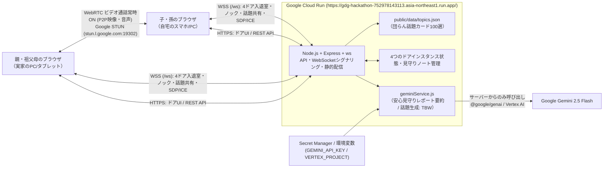

# DevFest GDGoC Japan 2026 Hackathon — プロダクト説明ドキュメント

## チーム情報

- **会場**：東京
- **チーム名**：Generator-Critic
- **メンバー**：yoikoarmor(小沢司)、suzukimain(鈴木崇博)

### アプリケーション名
**「となりドア」**

- **カテゴリ**：**医療・福祉**
- **GitHub リポジトリ URL**：https://github.com/yoikoarmor/GDG-hackathon

---

# 【必須項目】

## 1. プロジェクト概要

「となりドア」は、離れて暮らす親や祖父母の様子が気になる家族が、**廊下に並ぶ4つのドアの明かり（在室状況）から「今、声をかけてもいいタイミングか」を知り、ノックしてドアを開けるだけで顔を見ながら自然な団らんができる**Webアプリケーションです。

誰も入っていないドアは「空室（消灯）」ですが、家族の誰かがドアを開けて部屋に入ると、廊下のドアに明かりが灯り **`-yoikoarmor-がくつろいでいます。`** と表示されます。生の監視カメラ映像を常時垂れ流すのではなく「ドアの明かりと在室プレート」で気配を伝え、同じドアをノックして入室した家族同士だけを **WebRTC ビデオ通話（実カメラ／バーチャル茶の間カメラ常時ON）** でつなぎます。さらに「団らん話題カード（100選ランダム抽選 ＋ Gemini AI生成［TBW］）」と、退室後の **Gemini 2.5 Flash** による「安心見守りレポート（元気度・様子・次回の話題提案）」によって、離れて暮らす家族の孤立防止と継続的な見守りを実現します。

- **対象カテゴリ**：医療・福祉（高齢者見守り・遠距離家族ケア・孤立防止）
- **目的**：「用事がないと電話しづらい」という声かけのハードルと、「見守りカメラは監視されているようで嫌だ」というプライバシーへの抵抗感を同時に解消し、業務的でない温かい家族の団らんを取り戻すこと
- **プライバシーと安心の両立**：廊下（ロビー）には「どのドアに誰が入室中か」の明かりだけを表示して生映像の常時監視をなくし、同じドアに入った家族同士だけがお互いの顔を見ながら会話でき、退室後には **Gemini 2.5 Flash** が非医療的な会話の活気・様子メモを「安心見守りノート」として記録する設計を導入

---

## 2. 解決する課題

### 2.1. 対象ユーザー

- 離れて暮らす高齢の親や祖父母の様子が気になっている家族（子・孫世代）
- 一人暮らしや夫婦のみで暮らしており、家族と気軽に顔を見て話したい高齢者本人
- 見守りカメラの設置には抵抗があるが、日々の安否や元気さを自然に確かめ合いたい家族

### 2.2. 課題と根拠

高齢化や核家族化が進む日本では、離れて暮らす親や祖父母の安否・健康状態に対する家族の不安が大きくなっています。しかし、日常的なコミュニケーションには以下の3つの障壁が存在します。

1. **電話・連絡のタイミングの壁**：「今忙しいかな？」「寝ているかもしれない」「特別な用事がないのに電話するのは気が引ける」と躊躇してしまい、結果として連絡頻度が下がってしまう。
2. **監視カメラに対する心理的抵抗**：室内カメラによる常時見守りは、親世代にとって「プライバシーが侵害され、常に監視されている」という強いストレスになり、導入を拒否されるケースが多い。
3. **既存Web会議ツールの業務感と音声通話の限界**：ZoomやGoogle MeetはURL発行やスケジュール調整など「業務的」で、実家の茶の間のような「ふらっと顔を出して団らんする」温かみが生まれにくい。また、音声のみの電話では「顔色」「表情」「部屋の雰囲気」が分からず、「本当に元気かな？」という家族の心配を払拭しきれない。

本プロジェクトでは、**「4つのドアの明かりで今くつろいでいる場所・タイミングがわかること」**と**「あえてビデオ通話を基本にしたビデオ会議の団らん化」**を統合することで、これらの課題を解決します。

### 2.3. 既存手法との違い

| 観点 | 従来の手法（電話・見守りカメラ・Zoom等） | となりドア |
|---|---|---|
| **声をかけるタイミングの把握** | 分からない（いきなり電話するか、事前に予定調整が必要） | 4つのドアの明かりと **`-{アカウント名}-がくつろいでいます。`** のリアルタイム在室表示で一目で分かる |
| **プライバシーへの配慮** | 見守りカメラは生映像を常時配信するため「監視感」が強い | 廊下には「ドアの明かりと入室者名」だけを表示し、映像は同じドアに入った家族同士のブラウザ間（P2P）にしか届かない |
| **通話空間の体験（団らん化）** | Zoom等は会議室的で冷たく、会話のきっかけがないと沈黙しがち | 木目と暖簾の4つのドア（茶の間・縁側・ダイニング・趣味部屋）から入り、**100選の「団らん話題カード」（＋Gemini生成：TBW）**で自然に会話が弾む |
| **相手の様子・顔色の確認** | 音声電話では元気さや顔色が分からず心配が残る | **あえてビデオ通話を常時ON（実カメラまたはバーチャル茶の間カメラ）**にし、お互いの顔を見て安心できる |
| **通話後の家族間共有** | 通話した本人しか様子が分からない | 退室時に **Gemini 2.5 Flash** が「📓 安心見守りレポート（元気度・様子・次回の話題提案）」を自動生成し家族で共有できる |

---

## 3. Google技術の活用

### 3.1. 使用したGoogle技術 (少なくとも一つ選択)

- [ ] App Engine
- [ ] Compute Engine
- [ ] Google Kubernetes Engine（GKE）
- [x] **Cloud Run**
- [ ] Firebase App Hosting
- [ ] **Firebase Hosting**（静的なひとりデモ用設定のみ。共同利用は Cloud Run URL）

### 3.2. Google技術の活用例

| 使用技術 | 使用箇所 | 選定理由・メリット | デメリット |
|---|---|---|---|
| **Gemini API / Vertex AI (`gemini-2.5-flash` / `@google/genai`)** | ①退室後の「安心見守りレポート」自動要約（`POST /api/summary`） ②団らん話題カードの生成（TBW） | 会話の文脈・時間帯・気づきメモを高速に理解し、JSONスキーマ指定（Structured Outputs）によりUI表示用の構造化データを低遅延かつ安定して生成できる。Gemini API キーと Cloud Run 上の Vertex AI の両方に対応 | API利用料金やレート制限、応答遅延への配慮（12秒タイムアウトとローカル100選デッキへのフォールバック実装）が必要 |
| **Google Cloud Run** | フロントエンド配信、REST APIサーバー、4つのドアインスタンスのWebSocketシグナリングサーバー（`/ws`）の統合ホスティング | 単一コンテナで静的配信・Gemini呼び出し・WebSocket常時接続・自動SSL（`https://`）をすべて賄え、インフラ管理の負担が小さい | インメモリ状態管理を行う場合、複数インスタンスへスケールすると部屋状態が分散するため、最大インスタンス数制限（`max-instances=1`）やセッションアフィニティ設定が必要 |
| **Google STUN サーバー (`stun.l.google.com:19302`)** | 別ネットワーク（実家と自宅など）間の WebRTC ピア接続（NAT越え） | 映像・音声ストリームをサーバー中継・録画せずブラウザ間で直接P2P通信でき、低遅延かつプライバシー性が高い | 厳格なキャリアNAT（一部の4G/5G回線等）環境下ではTURNサーバーの追加が必要になる場合がある |
| **Google Cloud Secret Manager / 環境変数** | `GEMINI_API_KEY` や `GEMINI_VERTEX_PROJECT` 等の安全な設定管理 | 認証情報やAPIキーをフロントエンドやGitリポジトリに露出させず、Cloud Run サーバー内部のみから安全に Gemini を呼び出せる | デプロイ時にシークレット権限・IAMロールの設定が必要 |

### 3.3. Google技術を選定した理由

本プロジェクトでは、限られた開発期間内に「カメラ・マイクを使うWebRTCビデオ通話」「4つのドアの開閉・入室メンバー・話題カードを即座に同期するWebSocket通信」「会話を弾ませ見守り記録を残すAI処理」の3つを安全かつ確実に統合する必要がありました。

1. **Cloud Run による HTTPS + WebSocket + AI ゲートウェイの単一コンテナ統合**：
   ブラウザでカメラ映像（`getUserMedia`）を取得するには `https://` 環境が必須であり、また4つのドアの入退室やノック通知、WebRTCシグナリングには WebSocket の常時接続が必要です。**Cloud Run** を採用することで、自動SSL証明書発行・WebSocket対応・サーバーサイドでの Gemini 呼び出しを1つのコンテナ（`https://gdg-hackathon-752978143113.asia-northeast1.run.app/`）で実現しました。
2. **Gemini 2.5 Flash の高速レスポンスと構造化出力（JSON Schema）**：
   退室直後に「安心見守りレポート（元気度・様子・次回の話題提案）」を表示するには、待ち時間を感じさせない高速な応答性と、UIが壊れない厳密なJSON出力が不可欠です（通話中のリアルタイム話題カード生成は **TBW**）。**Gemini 2.5 Flash** と `@google/genai` SDK の `responseSchema` を組み合わせることで、温かい見守り要約を安定して生成できるようにしました。

---

## 4. アーキテクチャ図

---

## 5. プロジェクトをデプロイしたURL

- **アプリケーションURL**：https://gdg-hackathon-752978143113.asia-northeast1.run.app/
- **バーチャルカメラでの即時入室URL（カメラ非搭載PC用）**：https://gdg-hackathon-752978143113.asia-northeast1.run.app/?door=chanoma&cam=virtual

---

# 【任意項目】

## 6. 動作確認の方法

### 6.1. テストアカウント情報

本アプリは高齢者でも迷わずワンタップで使えるよう、パスワード入力不要で上部バーからアカウント名を即座に変更して体験できる設計になっています。

| 項目 | 内容 |
|---|---|
| **アクセスURL** | https://gdg-hackathon-752978143113.asia-northeast1.run.app/ |
| **初期アカウント名** | `yoikoarmor` または `suzukimain`（画面上部の入力欄で自由に変更可能） |
| **パスワード** | 不要（URLを開くだけですぐに全機能を体験可能） |

### 6.2. 動作確認手順

1. **4つのドアの一覧確認（ロビー画面）**：
   https://gdg-hackathon-752978143113.asia-northeast1.run.app/ にアクセスすると、「🍵 ドア1：実家の茶の間」「🌼 ドア2：日当たりのいい縁側」「🍲 ドア3：夕暮れの台所・ダイニング」「🧶 ドア4：みんなの趣味部屋」の4つの独立したドアが並んでいます。誰も入っていないドアは「空室」、誰かが入室中のドアには明かりが灯り **`-{アカウント名}-がくつろいでいます。`** とリアルタイム表示されます。
2. **ドアをノックして入室（1人目：明かりを灯して待つ）**：
   画面上部でアカウント名を確認・入力し、「🍵 実家の茶の間」の **「✊ ノックして入る」** をクリックします。ノック音とドアが開く演出の後、ビデオ団らんルームへ入室します。カメラは常時ON（実カメラ、またはカメラがない場合は「🍵 バーチャル茶の間カメラ」）となり、廊下の「実家の茶の間」のドアに **`-{あなたのアカウント名}-がくつろいでいます。`** と明かりが灯ります。
3. **2人目の入室とWebRTC双方向ビデオ通話の確認**：
   別端末（スマホ・別PC）または別ブラウザ／別タブで同じURL（https://gdg-hackathon-752978143113.asia-northeast1.run.app/ ）を開くと、「実家の茶の間」のドアに明かりが灯り、1人目がくつろいでいることが分かります。そのドアをノックして入室すると、待機カードが消えて**メイン映像枠に相手のカメラ映像が大きく映り、双方向のWebRTCビデオ通話**が始まります（廊下のドア表示は **`-{先頭アカウント名}-ほか計2人が団らん中`** に更新されます）。
4. **カメラ切替と絵文字リアクション**：
   自分の映像横にある「📷 実カメラ」「🍵 バーチャル茶の間カメラ」ボタンでいつでも映像モードを切り替えられます。また、リアクションボタン（👋 / 😊 / 😂 / 👍 / ❤️ / 🍵）を押すと、相手の画面にもアニメーション付きで絵文字が届きます。
5. **団らん話題カード（100選ランダム抽選 ＆ Gemini 生成［TBW］）**：
   右側の **「📇 話題カード100選から引く」** を押すとカードがめくれ、話題と会話のヒントが同じ部屋の全員の画面にリアルタイム共有されます（※Gemini による話題カード生成機能は **TBW**）。
6. **気づきメモの入力と退室・安心見守りレポートの確認**：
   右下の「📝 気づきメモ」でチップ（例：「😊 顔色よさそう」「😂 よく笑っていた」）を選択または自由入力し、**「🚪 ドアを閉めて退室（📝 Geminiが団らんレポートを作成）」** を押します。退室後にモーダルで Gemini 2.5 Flash がまとめた「📓 安心見守りレポート（元気度・様子・次回の話題提案）」が表示され、ロビー下部の **「📓 安心見守りノート」** に履歴として保存されます。

### 6.3. サンプルデータ

- **4つの独立したドアインスタンス**：
  - ドア1（`chanoma`）：「🍵 実家の茶の間 — 温かいお茶とテレビの音」
  - ドア2（`engawa`）：「🌼 日当たりのいい縁側 — ひだまりでのんびりひと休み」
  - ドア3（`kitchen`）：「🍲 夕暮れの台所・ダイニング — ごはんの香りに誘われて」
  - ドア4（`hobby`）：「🎨 みんなの趣味部屋 — 好きなことを持ち寄ろう」
- **団らん話題カード 100選（`public/data/topics.json`）**：
  - 「食事・料理」「季節・天気」「昔話・思い出」「暮らし・健康」「趣味・テレビ」「ご近所・地域」「家族・近況」「知恵袋・人生相談」「お出かけ・旅」「ちょっとした遊び・団らん」の10カテゴリ・計100件の話題カードを収録。

---

## 7. アプリの詳細や機能に関する自由記述

### 7.1. 主な機能

| # | 機能 | 内容 |
|---|---|---|
| **1** | **4つのドア＝4つの独立した団らんルームインスタンス** | 事前設定のダミー在室者を置かず、実際に誰かが入室しているドアだけに明かりが灯り **`-{アカウント名}-がくつろいでいます。`**（複数人なら **`-{アカウント名}-ほか計N人が団らん中`**）とリアルタイム表示します。 |
| **2** | **ビデオ通話常時ONの「団らんルーム」（WebRTC + バーチャル茶の間カメラ）** | 相手の顔色や様子を見て安心できるよう、入室中はカメラ常時ONを必須としています。カメラ非搭載端末や身支度前でも使えるよう、Canvasで描画される「🍵 バーチャル茶の間カメラ」へワンタップで切り替え可能です。 |
| **3** | **相手専用メイン映像枠と自動再生リカバリ** | 1人で入室中は提灯の灯る待機カードを表示し、相手が入室した瞬間にメイン枠へ相手のカメラ映像を大きく表示します。ブラウザの自動再生ブロック時もワンタップで音声・映像を復帰できるリカバリUIを備えています。 |
| **4** | **団らん話題カード（100選デッキ ＋ Gemini 生成［TBW］）** | 「特別な用事がなくても話が弾む」よう、100件の話題カードからのランダム抽選・カテゴリ絞り込み機能を備え、同室の家族全員の画面にリアルタイム共有します（Gemini による動的話題カード生成は **TBW**）。 |
| **5** | **Gemini 安心見守りレポート＆見守りノート** | 退室時に団らん時間・参加者・話した話題・気づきメモから Gemini 2.5 Flash が非医療的な「会話の活気（元気度）」「様子の要約」「次回おすすめの話題」を生成し、見守りノートに記録します。 |

### 7.2. 今後の展望

- **Cloud Firestore / Firebase Authentication との本格連携**：家族グループ単位での認証・招待機能と、複数 Cloud Run インスタンス間での永続的な見守りノート・ドア状態の同期
- **スマートディスプレイ・タブレット常設モード（実家専用キオスクUI）**：実家のリビングに置いたタブレットで、家族がドアをノックしたらワンタップで大きく応答できる高齢者特化モードの追加
- **TURN サーバー統合によるモバイル回線対応の強化**：厳格なキャリアNAT環境（4G/5G回線）下でもWebRTC映像の接続性を改善するリレー構成の導入

---

# 【採点外項目】

## 8. AIをどの場面でどう使用したか、なぜその場面で使用したか

本プロジェクトでは、**①サービスの中核機能としてのAI活用（Gemini 2.5 Flash）**と、**②開発プロセスにおけるマルチAIエージェント協調開発**の2つの軸でAIを徹底活用しました。

- **サービス機能での使用場面と理由（Google Gemini 2.5 Flash）**：
  - **見守り記録係・会話ファシリテーターとして**：退室後の「安心見守りレポート」自動要約（`POST /api/summary`、次回の話題提案を含む）に Gemini 2.5 Flash を活用しました（通話中の Gemini 団らん話題カード生成は **TBW**）。Cloud Run 上では API キーだけでなく Vertex AI 経由の呼び出しにも対応させています。
- **開発段階での使用場面と理由（マルチエージェント役割分担）**：
  短期間で高い完成度と堅牢性を実現するため、共通インターフェース仕様書（`API_CONTRACT.md`）および100件の話題データ（`public/data/topics.json`）を定義した上で、役割別にAIエージェントを使い分けました。
  - **構成詳細・バックエンド実装（Codex CLI: `gpt-6.1-sol`）**：Cloud Run 向けの Express + WebSocket サーバー、4ドアのルームインスタンス管理、`@google/genai` サービス層、およびパイプラインGIF生成スクリプトの実装に使用。
  - **フロントエンド・ドアUI実装（Claude Code CLI: `opus-5.5-mid`）**：暖簾や木目の温かみある4つのドアUI、バーチャル茶の間カメラ、WebRTCピア接続処理の実装に使用。
  - **高速バグ監査・回帰テスト検証（Codex CLI: `gpt-6-astra`）および統括（Antigravity）**：各AIが生成したコードの結合監査、WebRTC相手枠の切替テストや入退室エッジケースの自動テスト（`server/smokeTest.js`, `server/frontendTest.js`）による検証・修正を実施しました。

---

## 9. 自分たちが開発を通して何を得て、どれくらい成長できたのか

1. **社会課題を「シンプルで迷わない空間設計」へ磨き上げるプロダクト思考**：
   最初は「誰が常時どこにいるかを設定する仕組み」や「デモ用の仮想おばあちゃん」を入れていましたが、実際に触って議論する中で「4つのドアがそれぞれ1つの部屋（インスタンス）として存在し、入った人だけがそこにいてビデオ通話できる方がずっと自然で直感的だ」と気づき、思い切ってシンプルな4ドア・ルームインスタンス方式へとピボットしました。機能を増やすことよりも、高齢者や家族が迷わず使える本質的なUXへ削ぎ落とす判断力を得ることができました。
2. **Google Cloud Run と Gemini API・WebRTC を組み合わせた実践的なリアルタイム設計力**：
   WebSocketによる4部屋のリアルタイム入退室同期、WebRTCによるP2P映像通信、そして `@google/genai` SDK（Gemini API / Vertex AI）による構造化出力を1つの Cloud Run コンテナ上で安全に共存させるアーキテクチャ設計を学びました。
3. **複数AIエージェントを「契約仕様（API Contract）」と「自動テスト」で統制する開発手法**：
   方針変更（ピボット）の際にも、まず `API_CONTRACT.md` を更新してからバックエンド担当AI・フロントエンド担当AI・テスト監査AIへ役割を振り分け、自動テスト（`npm test`）で品質を担保しながら高速に改修を完了させる「AI時代のチーム開発ワークフロー」を体得できました。
