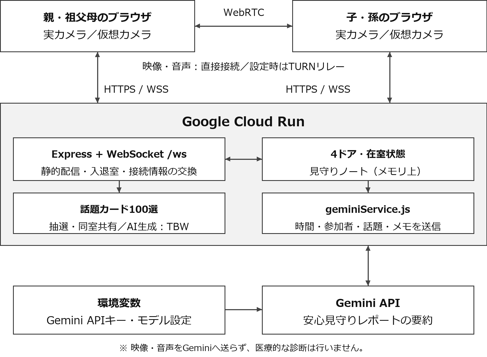

# DevFest GDGoC Japan 2026 Hackathon

## チーム情報

- 会場：東京
- チーム名：Generator-Critic
- メンバー：yoikoarmor(小沢司)、suzukimain(鈴木崇博)

## アプリケーション名

「となりドア」

- カテゴリ：医療・福祉
- GitHub リポジトリ URL：https://github.com/Devfest-Hackathon-2026/df-2026-t043

# 【必須項目】

## 1.　プロジェクト概要

「となりドア」は、離れて暮らす家族が、4つのドアの明かりから在室状況を知り、ノックして入室するとビデオ通話で団らんできるWebアプリケーションです。話題カード100選と、退室後のGeminiによる安心見守りレポートで、会話のきっかけと振り返りを支えます。

目的：「用事がないと電話しづらい」「見守りカメラには抵抗がある」という負担を減らすこと。ZoomやMicrosoft Teamsなどの既存のビデオ通話とは違う体験として、家族が気軽に集まり、団らんを過ごせる場所へと昇華させることを目指します。

プライバシーへの配慮：ロビーに表示するのは在室者名と人数です。映像は同じドアの参加者へ届け、アプリは録画しません。

## 2.　解決する課題

### 2.1.　対象ユーザー

・離れて暮らす親や祖父母の様子が気になる家族

・日々、家族の様子を見に行くことに負担を感じている人

・家族と気軽に顔を見て話したい高齢者本人

・見守りカメラに抵抗があり、自然に安否を確かめ合いたい人

### 2.2.　課題と根拠

毎日の訪問には時間や移動の負担があり、電話も「今忙しいかもしれない」「用事がないとかけづらい」とためらいがちです。一方、常設カメラは監視される抵抗感につながります。既存のビデオ会議の業務的な印象も、気軽な団らんにはなじみにくいと考えました。

### 2.3.　既存手法との違い

| 観点 | 従来の電話・カメラ・会議 | となりドア |
| --- | --- | --- |
| 声かけのタイミング | 予定調整や事前の連絡が必要 | ドアの明かりと在室表示で知る |
| 過ごし方 | 用件や会議を中心に接続する | 同じ部屋で過ごす感覚で団らん |
| 見守り | 訪問の負担や常時監視の抵抗感 | 実カメラで顔を確認し、入力メモを振り返る |

## 3.　Google技術の活用

### 3.1.　使用したGoogle技術（少なくとも一つ選択）

- [ ] App Engine
- [ ] Compute Engine
- [ ] Google Kubernetes Engine（GKE）
- [x] Cloud Run
- [ ] Firebase App Hosting
- [ ] Firebase Hosting

### 3.2.　Google技術の活用例

| 使用技術 | 使用箇所 | 選定理由・メリット | デメリット |
| --- | --- | --- | --- |
| Gemini API | 退室後の安心見守りレポート要約。通話中の話題生成はTBW | 時間・参加者・話題・気づきメモから、画面に表示しやすい構造化された要約を生成できる | APIの料金・遅延・失敗への配慮が必要。失敗時は簡易記録へ切替 |
| Cloud Run | Web配信、REST API、WebSocketの統合ホスティング | HTTPSとリアルタイム通信を1つのコンテナで運用できる | 在室情報はメモリ上にあるため、複数インスタンスへの拡張に追加設計が必要 |
| Google STUN | WebRTCの直接接続の支援 | 異なるネットワーク間でブラウザ同士の接続を試みられる | 直接接続が難しい環境ではTURNリレーを利用。実回線の接続検証が必要 |

### 3.3.　Google技術を選定した理由

Cloud Runなら、カメラ利用に必要なHTTPS、ドアの在室同期に使うWebSocket、APIと画面配信をまとめて提供できます。限られた開発期間でも、サービス全体を公開しやすい点を重視しました。

Gemini APIは、参加者が入力したメモなどを、様子・話題・次回の提案として整理するために使います。映像や音声そのものは解析せず、非医療的な会話の記録として扱います。

## 4.　アーキテクチャ図

4つのドアはそれぞれ独立したルームです。Expressは接続情報を交換し、映像・音声は直接接続またはTURNリレーで同室の参加者へ届けます。事前の静止画気配抽出・デモ人物は廃止しています。

## 5.　プロジェクトをデプロイしたURL

アプリケーションURL： https://gdg-hackathon-752978143113.asia-northeast1.run.app/

仮想カメラでの入室URL： https://gdg-hackathon-752978143113.asia-northeast1.run.app/?door=chanoma&cam=virtual

# 【任意項目】

## 6.　動作確認の方法

### 6.1.　テストアカウント情報

| 項目 | 内容 |
| --- | --- |
| アクセスURL | https://gdg-hackathon-752978143113.asia-northeast1.run.app/ |
| アカウント名 | 任意の表示名を入力可能。例：yoikoarmor、suzukimain |
| パスワード | 不要。アカウント名は表示名で、認証機能ではありません。 |

### 6.2.　動作確認手順

1. 上記URLを2端末、または2つのブラウザで開き、表示名を入力します。

2. 一方で任意のドアをノックして入室します。入室したドアの明かりが灯り、1人の在室表示になることを確認します。

3. もう一方で同じドアに入室し、相手の映像と2人の在室表示を確認します。カメラがない場合は仮想カメラで参加できます。

4. 「話題カード100選から引く」を押し、同室者にも同じカードが表示されることを確認します。Geminiによる通話中の話題生成はTBWです。

5. 気づきメモを入力して退室し、安心見守りレポートとノートを確認します。AIに接続できない場合は簡易記録になります。

### 6.3.　サンプルデータ

4つのドア：実家の茶の間（chanoma）、日当たりのいい縁側（engawa）、夕暮れの台所・ダイニング（kitchen）、みんなの趣味部屋（hobby）。固定の在室者は設定せず、実際の入室に応じて点灯します。

話題カード：食事・料理、季節・天気、昔話・思い出など、10カテゴリ・100件を用意しています。

## 7.　アプリの詳細や機能に関する自由記述

### 7.1.　主な機能

| # | 機能 | 内容 |
| --- | --- | --- |
| 1 | 4つの独立ルーム | 入室している人の名前と人数を表示。空室は消灯します。 |
| 2 | ビデオ団らん | 実カメラ、または仮想の茶の間映像で参加。仮想カメラでは本人の顔は映りません。 |
| 3 | 話題カード100選 | カテゴリで絞り込み、引いたカードを同室の参加者へ共有。Gemini話題生成はTBWです。 |
| 4 | 安心見守りレポート・ノート | 時間・参加者・話題・気づきメモから要約。元気度は非医療的な目安で、根拠がなければ未評価。履歴はメモリ上に最大100件で、再起動すると失われます。 |

### 7.2.　今後の展望

・家族グループの認証・招待と、Firestoreによる履歴の永続化

・高齢者が使いやすい、タブレットの常設モード

・導入済みTURNの実回線検証と接続品質の改善

# 【採点外項目】

## 8.　AIをどの場面でどう使用したか、なぜその場面で使用したか

サービス機能：Gemini APIを退室後の記録の要約に使っています。入力メモなどを読みやすく整理し、次回の話題を提案するためです。通話中の話題カード生成はTBWです。

開発段階：Codex、Claude Code、Antigravityを、設計の検討、コード生成、エラー調査、結合確認、話題データや図の作成に使いました。共通のAPI契約を参照しながら、バックエンド・フロントエンド・検証を分担しました。

## 9.　自分たちが開発を通して何を得て、どれくらい成長できたのか

何が必要で、何がいらないかを取捨選択する力

最初の案は、今よりも大きなシステムでした。ただ、そのままでは目的と手段が入れ替わり、使う人をないがしろにした設計になりかねませんでした。そこで「この機能は本当に必要か」「使う人が望んでいるものは何か」を考え、機能の追加と削減を繰り返しました。その結果、最小限の機能で最大限の価値を提供することを目指した、今の設計になりました。

公開サービスの作成と共同開発を通じて学んだこと

Cloud Runを使ってWebサービスを公開し、GitHubのリポジトリを共有しながら共同開発する経験を得ました。

一方で、今回はAIを使う際にアイデアを先行させすぎたため、AIにコードを書かせた後のバグ修正に手間取りました。これは、自分たちが機能全体を十分に把握できていなかったことの表れだと感じています。AIを使う場合も、これまでの開発と同じように、機能定義と情報のやり取りのパイプラインをしっかり組み立ててから取り組むべきだと学びました。
