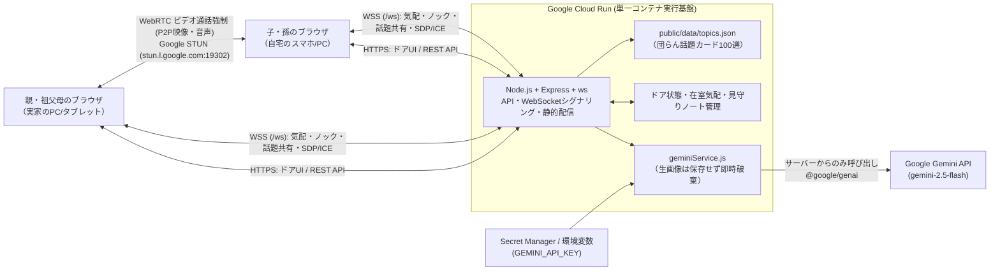

# DevFest GDGoC Japan 2026 Hackathon — プロダクト説明ドキュメント

## チーム情報

- **会場**：東京
- **チーム名**：Generator-Critic
- **メンバー**：yoikoarmor, kaigunn_2020 (suzukimain)

### アプリケーション名
**「となりドア」**

- **カテゴリ**：**医療・福祉**
- **GitHub リポジトリ URL**：https://github.com/yoikoarmor/GDG-hackathon

---

# 【必須項目】

## 1. プロジェクト概要

「となりドア」は、離れて暮らす親や祖父母の様子が気になる家族が、**「今、声をかけてもいいタイミングか」をドア越しの温かい気配で知り、ノックしてドアを開けるだけで顔を見ながら自然な団らんができる**Webアプリケーションです。

親・祖父母側の様子（カメラの静止画1枚やひとこと状況）を **Gemini 2.5 Flash** が解析し、生の監視映像を送るのではなく **`-おばあちゃん-がくつろいでいます。`（声かけタイミング：◎）** という優しい気配に変換してドアの明かりとして伝えます。ドアを開けて入室すると、**あえてビデオ通話を常時ON（実カメラ／バーチャル茶の間カメラ）にする団らん空間**に繋がり、話題カード（100選＋Geminiリアルタイム生成）や退室後の「安心見守りレポート」によって、離れて暮らす家族の孤立防止と継続的な見守りを実現します。

- **対象カテゴリ**：医療・福祉（高齢者見守り・遠距離家族ケア・孤立防止）
- **目的**：「用事がないと電話しづらい」という声かけのハードルと、「見守りカメラは監視されているようで嫌だ」というプライバシーへの抵抗感を同時に解消し、業務的でない温かい家族の団らんを取り戻すこと
- **プライバシーと安心の両立**：生映像を常時配信・保存せず、入室前は「Geminiによる気配の抽象化」、入室中は「双方が納得して顔を合わせるビデオ団らん」、退室後は「非医療的な会話の活気・様子メモ（安心見守りノート）」という3段階のケア設計を導入

---

## 2. 解決する課題

### 2.1. 対象ユーザー

- 離れて暮らす高齢の親や祖父母の様子が気になっている家族（子・孫世代）
- 一人暮らしや夫婦のみで暮らしており、家族と気軽に顔を見て話したい高齢者本人
- 見守りカメラの設置には抵抗があるが、日々の安否や元気さを自然に確かめ合いたい家族

### 2.2. 課題と根拠

高齢化や核家族化が進む日本では、離れて暮らす親や祖父母の安否・健康状態に対する家族の不安が大きくなっています。しかし、日常的なコミュニケーションには以下の3つの障壁が存在します。

1. **電話・連絡のタイミングの壁**：「今忙しいかな？」「寝ているかもしれない」「特別な用事がないのに電話するのは気が引ける」と躊躇してしまい、結果として連絡頻度が下がってしまう。
2. **監視カメラに対する心理的抵抗**：室内カメラによる常時見守りは、親世代にとって「プライバシーが侵害され、常に監視されている」という強いストレスになり、導入を拒否されるケースが多い。
3. **既存Web会議ツールの業務感と音声通話の限界**：ZoomやGoogle MeetはURL発行やスケジュール調整など「業務的」で、かつてのSkypeや実家の茶の間のような「ふらっと顔を出して団らんする」温かみが生まれにくい。また、音声のみの電話では「顔色」「表情」「部屋の雰囲気」が分からず、「本当に元気かな？」という家族の心配を払拭しきれない。

本プロジェクトでは、**「声をかけるタイミングがわかること」**と**「あえてビデオ通話を基本にしたビデオ会議の団らん化」**を統合することで、これらの課題を解決します。

### 2.3. 既存手法との違い

| 観点 | 従来の手法（電話・見守りカメラ・Zoom等） | となりドア |
|---|---|---|
| **声をかけるタイミングの把握** | 分からない（いきなり電話するか、事前に予定調整が必要） | ドアの明かりと **`-{アカウント名}-がくつろいでいます。`** の表示、および Gemini のタイミング判定（◎/○/△）で一目で分かる |
| **プライバシーへの配慮** | 見守りカメラは生映像を常時配信するため「監視感」が強い | カメラ画像は Gemini が「気配のひとこと」に抽象化した後に即時破棄し、生映像は保存・配信しない |
| **通話空間の体験（団らん化）** | Zoom等は会議室的で冷たく、会話のきっかけがないと沈黙しがち | 木目と暖簾の「ドア（茶の間・縁側など）」から入り、**100選＋Gemini生成の「団らん話題カード」**で自然に会話が弾む |
| **相手の様子・顔色の確認** | 音声電話では元気さや顔色が分からず心配が残る | **あえてビデオ通話を強制（実カメラまたはバーチャル茶の間カメラ常時ON）**し、顔を見て安心できる |
| **通話後の家族間共有** | 通話した本人しか様子が分からない | 退室時に Gemini が「📓 安心見守りレポート（元気度・様子・次回の話題提案）」を自動生成し家族で共有できる |

---

## 3. Google技術の活用

### 3.1. 使用したGoogle技術 (少なくとも一つ選択)

- [ ] App Engine
- [ ] Compute Engine
- [ ] Google Kubernetes Engine（GKE）
- [x] **Cloud Run**
- [ ] Firebase App Hosting
- [ ] **Firebase Hosting**（静的なひとりデモ用設定のみ。共同利用は Cloud Run URL）

### 3.2. Google技術の活用例

| 使用技術 | 使用箇所 | 選定理由・メリット | デメリット |
|---|---|---|---|
| **Gemini API (`gemini-2.5-flash` / `@google/genai`)** | ①ドア越しの気配・声かけタイミング解析（マルチモーダル） ②団らん話題カードのリアルタイム生成 ③退室後の「安心見守りレポート」生成 | 画像（カメラフレーム）とテキスト（状況メモ）を高速に統合理解でき、JSONスキーマ指定（Structured Outputs）によりUI表示用の構造化データを安定して生成できる | API利用料金やレート制限、応答遅延への配慮（タイムアウトとローカル100選デッキへのフォールバック実装）が必要 |
| **Google Cloud Run** | フロントエンド配信、REST APIサーバー、WebSocketシグナリングサーバー（`/ws`）の統合ホスティング | 単一コンテナで静的配信・Gemini API呼び出し・WebSocket常時接続・自動SSL（`https://`）をすべて賄え、インフラ管理の負担が小さい | インメモリ状態管理を行う場合、複数インスタンスへスケールすると部屋状態が分散するため、最大インスタンス数制限やセッションアフィニティ設定が必要 |
| **Google STUN サーバー (`stun.l.google.com:19302`)** | 別ネットワーク（実家と自宅など）間の WebRTC ピア接続（NAT越え） | 映像・音声ストリームをサーバー中継せずブラウザ間で直接P2P通信でき、低遅延かつプライバシー性が高い | 厳格なキャリアNAT（一部の4G/5G回線等）環境下ではTURNサーバーの追加が必要になる場合がある |
| **Google Cloud Secret Manager / 環境変数** | `GEMINI_API_KEY` 等の機密情報の安全な注入 | APIキーをフロントエンドやGitリポジトリに露出させず、Cloud Run サーバー内部のみから安全に Gemini API を呼び出せる | デプロイ時にシークレット権限設定が必要 |

### 3.3. Google技術を選定した理由

本プロジェクトでは、限られた開発期間内に「カメラ・マイクを使うWebRTCビデオ通話」「ドアの気配や話題カードを即座に同期するWebSocket通信」「カメラ画像を外部に漏らさず気配へ変換するAI処理」の3つを安全かつ確実に統合する必要がありました。

1. **Cloud Run による HTTPS + WebSocket + AI ゲートウェイの単一コンテナ統合**：
   ブラウザでカメラ映像（`getUserMedia`）を取得するには `https://` 環境が必須であり、またドアのノックや気配更新には WebSocket の常時接続が必要です。**Cloud Run** を採用することで、自動SSL証明書発行・WebSocket対応（セッションアフィニティ）・サーバーサイドでの `GEMINI_API_KEY` 秘匿を1つのコンテナで実現しました。
2. **Gemini 2.5 Flash のマルチモーダル性能と高速レスポンス**：
   「監視カメラにしない見守り」を実現するため、親側のカメラ静止画と状況メモを **Gemini 2.5 Flash** に渡し、個人識別や室内の詳細を省いた「声かけタイミング度（◎/○/△）」へと瞬時に抽象化する仕組みを構築しました。さらに会話中のリアルタイム話題生成でも、Gemini 2.5 Flash の低遅延な応答性と JSON Schema 出力により、家族の団らんを止めないスムーズなファシリテーションを実現しています。

---

## 4. アーキテクチャ図

---

## 5. プロジェクトをデプロイしたURL

- **アプリケーションURL**：`https://tonari-door-danran-xxxxxxxxxx-an.a.run.app`（※Cloud Run 発行URLを記載）
- **1台PC用クイック体験URL（バーチャル茶の間カメラで即入室）**：`https://tonari-door-danran-xxxxxxxxxx-an.a.run.app/?door=chanoma&cam=virtual`

---

# 【任意項目】

## 6. 動作確認の方法

### 6.1. テストアカウント情報

本アプリは高齢者でも迷わずワンタップで使えるよう、パスワード入力不要で上部バーからアカウント名を即座に切り替えて体験できる設計になっています。

| 項目 | 内容 |
|---|---|
| **アクセスURL** | 上記アプリケーションURL（ローカル実行時は `http://localhost:8080`） |
| **初期アカウント名（子・孫側）** | `yoikoarmor` または `kaigunn_2020`（画面上部で自由に変更可能） |
| **初期アカウント名（親・実家側）** | `おばあちゃん` / `母（実家）`（1人デモ時は自動で家族シミュレーターが応答） |
| **パスワード** | 不要（URLを開くだけですぐに全機能を体験可能） |

### 6.2. 動作確認手順

1. **ドア越しの気配確認（ロビー画面）**：
   アプリURLにアクセスすると、「🍵 実家の茶の間」「🌼 日当たりのいい縁側」「🍲 夕暮れの台所」「🧶 みんなの趣味部屋」の4つのドアが並び、各ドアに **`-おばあちゃん-がくつろいでいます。`** などの気配と声かけタイミング度（`◎ 声をかけるのにぴったり`）が表示されていることを確認します。
2. **自分の気配をドアに灯す**：
   画面上部のコントロールバーで「あなたのアカウント名」と「くつろぐドア」を選び、**「🏮 ここでくつろぐ」** ボタンを押すと、該当ドアのプレートが即座に **`-{入力したアカウント名}-がくつろいでいます。`** に切り替わることを確認します。
3. **Gemini による声かけタイミング判定**：
   **「📸 カメラ/状況からGeminiで声かけタイミングを更新」** ボタンを押し、状況チップ（例：「お茶を飲みながらひと休み中」「夕ごはんの支度中」）を選んで **「✨ Geminiで声かけタイミングを判定」** を押すと、カメラ画像と状況から声かけタイミング度と一言コメントが更新されることを確認します。
4. **ドアをノックして団らんルームへ入室（ビデオ通話強制）**：
   「🍵 実家の茶の間」の **「✊ コンコン ノックして入る」** をクリックすると、ノック音とドアが開く演出の後、ビデオ通話画面（団らんルーム）に入室します。カメラOFFボタンが存在せず、必ず「📷 実カメラ」または「🍵 バーチャル茶の間カメラ」がONになることを確認します。
5. **1人でも2人でも試せるビデオ団らん＆リアクション**：
   - **1人で確認する場合**：向かい側に「家族シミュレーター（おばあちゃん）」のライブCanvas映像が表示され、下のリアクションボタン（👋 / 😊 / 🍵 など）を押すとおばあちゃんが手を振ったりお茶を飲んだりして返事することを確認します。
   - **2タブ（または別端末）で確認する場合**：もう1つのブラウザタブで同じURLを開いて同じドアに入室すると、WebRTC で実際の双方向ビデオ通話に繋がることを確認します。
6. **団らん話題カード（100選ランダム ＆ Gemini生成）**：
   右側の **「🎲 話題カードをランダムに引く（全100件）」** を押すとカードがめくれ、話題と会話のヒントが表示（2タブ時は相手側にも同期）されます。続いて **「✨ Geminiに今の話題を作ってもらう」** を押すと、季節や時間帯に応じた新しい話題カードが生成されることを確認します。
7. **気づきメモの入力と退室**：
   右下の「📝 気づきメモ」でチップ（例：「😊 顔色よさそう」「😂 よく笑っていた」）をクリックし、**「🚪 ドアを閉めて退室（見守り記録を残す）」** ボタンを押します。
8. **安心見守りレポートの確認**：
   退室後にモーダルで Gemini がまとめた「📓 安心見守りレポート（元気度・様子・次回の話題提案）」が表示され、ロビー画面下部の **「📓 安心見守りノート」** に履歴として保存されていることを確認します。

### 6.3. サンプルデータ

アプリには最初からすぐに動作確認できる以下のサンプルデータを搭載しています。
- **4つの初期ドアと在室気配データ**：
  - 「🍵 実家の茶の間」：`-おばあちゃん-がくつろいでいます。`
  - 「🌼 日当たりのいい縁側」：`-母（実家）-がくつろいでいます。`
  - 「🍲 夕暮れの台所・ダイニング」：`-kaigunn_2020-がくつろいでいます。`
  - 「🧶 みんなの趣味部屋」：`-yoikoarmor-がくつろいでいます。`
- **団らん話題カード 100選（`public/data/topics.json`）**：
  - 「食事・料理」「季節・天気」「昔話・思い出」「暮らし・健康」「趣味・テレビ」「ご近所・地域」「家族・近況」「知恵袋・人生相談」「お出かけ・旅」「ちょっとした遊び・団らん」の10カテゴリ・計100件の話題カードを収録。

---

## 7. アプリの詳細や機能に関する自由記述

### 7.1. 主な機能

| # | 機能 | 内容 |
|---|---|---|
| **1** | **ドア越しの気配表示（`-{アカウント名}-がくつろいでいます。`）** | 監視カメラのように生映像を見せるのではなく、ドアの明かりとプレート表示で家族の在室気配を伝え、「今電話していいかな？」という迷いを解消します。 |
| **2** | **Gemini マルチモーダル声かけタイミング判定** | カメラの静止画1枚とひとことメモを Gemini 2.5 Flash が解析し、「◎ 声をかけるのにぴったり」「○ 少しなら話せそう」「△ 今はそっとしておこう」の3段階で判定します。生画像はサーバー上で即時破棄されます。 |
| **3** | **ビデオ通話強制の「団らんルーム」（WebRTC + バーチャル茶の間カメラ）** | 相手の顔色や様子を見て安心できるよう、入室中はカメラ常時ONを必須としています。カメラがないPCや身支度前でも使えるよう、Canvasで描画される「🍵 バーチャル茶の間カメラ」へワンタップで切り替え可能です。 |
| **4** | **団らん話題カード（100選デッキ ＋ Gemini リアルタイム生成）** | 「特別な用事がなくても話が弾む」よう、100件の話題カードからのランダム抽選・カテゴリ絞り込みに加え、Gemini 2.5 Flash がその場の文脈に合った新しい話題カードを生成し、同室の家族全員の画面にリアルタイム共有します。 |
| **5** | **1人でも実演できる「家族シミュレーター」** | 審査員の方が1人で触る際にも団らんの雰囲気が伝わるよう、対向ピア不在時は「家族シミュレーター（おばあちゃん）」が自動登場し、話題カードや絵文字リアクションに合わせてお辞儀・笑顔・お茶飲み・吹き出しで応答します。 |
| **6** | **Gemini 安心見守りレポート＆見守りノート** | 退室時に団らん時間・話した話題・気づきメモから Gemini 2.5 Flash が非医療的な「会話の活気（元気度）」「様子の要約」「次回おすすめの話題」を生成し、家族間で共有できる見守りノートに記録します。 |

### 7.2. 今後の展望

- **Cloud Firestore / Firebase Authentication との本格連携**：家族グループ単位での認証・招待機能と、複数 Cloud Run インスタンス間での永続的な見守りノート・ドア状態の同期
- **スマートディスプレイ・タブレット常設モード（実家専用キオスクUI）**：実家のリビングに置いたタブレットが自動で時間帯や部屋の明るさから気配を更新し、ノックされたらワンタップで大きく応答できる高齢者特化モードの追加
- **TURN サーバー統合によるモバイル回線対応の強化**：厳格なキャリアNAT環境（4G/5G回線）下でもWebRTC映像の接続性を改善するリレー構成の導入

---

# 【採点外項目】

## 8. AIをどの場面でどう使用したか、なぜその場面で使用したか

本プロジェクトでは、**①サービスの中核機能としてのAI活用（Gemini API）**と、**②開発プロセスにおけるマルチAIエージェント協調開発**の2つの軸でAIを徹底活用しました。

- **サービス機能での使用場面と理由（Google Gemini 2.5 Flash）**：
  1. **プライバシーを守る「気配の翻訳機」として**：親の姿をそのまま映像で送ると「監視」になってしまいますが、単なる手動ステータスでは更新されなくなります。カメラ画像と状況メモを Gemini 2.5 Flash で「声かけタイミング度（◎/○/△）」と優しい一言に抽象化することで、プライバシー保護と見守りを両立できると考え採用しました。
  2. **会話のファシリテーター・見守り記録係として**：久しぶりの家族通話で話題に詰まる課題を解決するため、Gemini によるリアルタイム話題カード生成と、退室後の「安心見守りレポート」自動要約に活用しました。
- **開発段階での使用場面と理由（マルチエージェント役割分担）**：
  短期間で高い完成度と堅牢性を実現するため、先に人間と統括エージェント（Antigravity）で厳密なインターフェース仕様書（`API_CONTRACT.md`）および100件の話題データ（`public/data/topics.json`）を定義した上で、役割別にAIエージェントを使い分けました。
  - **構成詳細・バックエンド実装（Codex CLI）**：Cloud Run 向けの Express + WebSocket サーバー、レート制限、入力検証、`@google/genai` サービス層、およびパイプラインGIF生成スクリプトの実装に使用。
  - **フロントエンド・ドアUI実装（Claude Code CLI）**：暖簾や木目の温かみあるドアUI、Canvasによるバーチャル茶の間カメラ・家族シミュレーター、WebRTCピア接続処理の実装に使用。
  - **統括・結合監査・検証（Antigravity）**：各AIが生成したコードの結合時に発生したエッジケース（複数ドア間の気配移動時の重複解除、同一PC・2タブ間での接続IDベース同期など）を検出し、自動スモークテスト（`server/smokeTest.js`）による検証と修正を実施しました。

---

## 9. 自分たちが開発を通して何を得て、どれくらい成長できたのか

1. **社会課題を「技術の押しつけ」ではなく「心理的ハードルの解消」から設計する視点**：
   最初は「離れて暮らす親の様子を知るにはどうすればいいか」「昔のSkypeのように業務的でない団らんをどう作るか」という2人の素朴なアイデアからスタートしました。議論を重ねる中で、「監視カメラのように常時映像を見せるのは親が嫌がる」「でも声だけでは顔色が分からず心配が残る」というトレードオフに気づき、**「ドアの外ではGeminiで抽象化した『気配（`-{アカウント名}-がくつろいでいます。`）』だけを伝え、ドアを開けた中ではあえてビデオ通話を強制して顔を見せ合う」**という、福祉・家族ケアに寄り添った独自のUX設計へと昇華させることができました。
2. **Google Cloud Run と Gemini API・WebRTC を組み合わせた実践的なリアルタイム設計力**：
   単なるチャットボットではなく、WebSocketによるリアルタイム状態同期、WebRTCによるP2P映像通信、そして `@google/genai` SDK によるマルチモーダル構造化出力を1つの Cloud Run コンテナ上で安全に共存させるアーキテクチャ設計を学びました。特に、APIキー未設定時やカメラ非搭載環境でもデモが絶対に止まらないフォールバック設計の重要性を体得しました。
3. **複数AIエージェントを「契約仕様（API Contract）」と「自動テスト」で統制する開発手法**：
   AIに漫然とコードを書かせるのではなく、最初に人間がコアコンセプトと `API_CONTRACT.md`（エンドポイント・WebSocketイベント・データ型）を定義し、バックエンド担当AIとフロントエンド担当AIを並列稼働させ、最後に結合テストで不整合を潰すという「AI時代のチーム開発ワークフロー」を実践し、開発速度と品質の両面で大きな成長を得ることができました。

## 現実装の検証範囲・制約

初期在室者・バーチャル映像はデモであり、実在者の顔色・安否を示しません。要約は時間・話題・参加者・任意メモから作り、通話映像・音声は解析しません。AI失敗時やメモのない場合の元気度は未評価です。
現状は認証なし・インメモリ共有のデモです。家族単位の認可、永続化、TURNは未実装です。Cloud Runの単一インスタンスで使用し、実デプロイURLと2端末での接続を提出前に確認してください。URL欄は現時点でプレースホルダーです。
